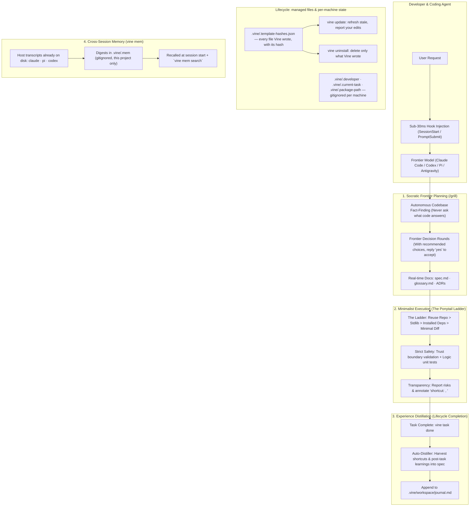

<p align="center">
  <h1 align="center">🌿 Vine</h1>
  <p align="center">
    <strong>The Agile AI Coding Harness</strong><br>
    <em>Freedom to reason. Discipline to ship.</em>
  </p>
  <p align="center">
    <a href="#english">English</a> • <a href="#-中文说明">简体中文</a>
  </p>
</p>

<p align="center">
  
  
  
  
  
  
</p>

---

## English

### What is Vine?

Modern frontier models (Gemini 2.5/3, Claude 3.5/3.7, GPT-4.5/o1/o3) have evolved far beyond early code-generation bots. Yet legacy AI frameworks still treat them like rigid assembly-line workers—imposing artificial gates, forcing one-question-per-turn bureaucracy, requiring multiple fragmented metadata files, and burning thousands of prompt tokens on orchestration overhead.

**Vine** is a lightweight, pragmatic engineering harness that unchains the model's intellect while keeping your repository disciplined, safe, and organized.

It fuses the best of three battle-tested open-source philosophies:
- 🏛️ **Trellis** (`mindfold-ai/Trellis`): Lifecycle task tracking, living specifications, and sub-millisecond automated hook injection—*completely stripped of bureaucratic micro-management*.
- ✂️ **Ponytail** (`DietrichGebert/ponytail`): The lazy senior developer philosophy—*“The best code is the code never written. Solve with the least new code.”*
- 💡 **grill-with-docs** (`mattpocock/skills`): Socratic Frontier brainstorming—*fact-finding autonomy, batch frontier rounds with recommended choices, and real-time living docs crystallization*.

---

### Comparison

| Dimension | Legacy Harnesses (e.g. Trellis) | Minimal Prompts (e.g. Ponytail) | **Vine (This Project)** |
| :--- | :--- | :--- | :--- |
| **Model Philosophy** | Micromanages the agent with multi-phase lockouts | Unconstrained single prompt, no persistent task board | **Guided Autonomy**: Guardrails without handcuffs |
| **Questions & Planning** | Rigid: forced 1 question per turn, PRD/Design splits | None: skips questioning | **Socratic Frontier**: Batched decision rounds with recommendations |
| **Fact Finding** | Often asks user obvious codebase questions | N/A | **Fact Independence**: Search repo first; never ask what code knows |
| **Code Implementation** | Heavy wrappers, forces multi-agent delegation | The Ponytail Ladder: minimum viable code diff | **Ponytail Ladder**: Reuse > Stdlib > Installed > Minimal working code |
| **Living Documentation** | Complex nested manual specs | None | **Real-time Docs**: Inline `glossary.md` updates & ADR generation |
| **Lifecycle & Memory** | Heavy multi-file tracking (`prd`, `design`, `jsonl`) | Diff only | **Unified `spec.md` + Notes**; auto post-task learning distillation |
| **Runtime Footprint** | Multi-language, heavy CLI dependencies | Node scripts | **Zero-dependency Python 3 standard library** + 36 kB npm package |
| **Hook Latency** | 200ms – 1000ms multi-process execution | Fast | **~22ms** measured (11ms of it is CPython startup) |
| **Upgrades** | `update` + hash manifest + migrations | Plugin marketplace | **`vine update`** with a hash manifest; user-edited files are reported, never overwritten |
| **Uninstall** | Removes `.trellis/` and every generated file | Host `plugin remove` | **`vine uninstall`** removes only files it wrote, and never a file you edited |

---

### Architecture



---

### Quick Start

#### 1. Installation

Install via npm (recommended, zero-install via npx available) or pip:

```bash
# Option A: Global via npm
npm install -g vine-harness

# Option B: Run instantly via npx (zero installation)
npx vine-harness init

# Option C: Python package
pip install -e .
```

#### 2. Initialize in Your Repository

Vine supports **on-demand platform initialization** (like Trellis), creating only the adapters you actually use:

```bash
# Initialize only the platforms you need:
vine init --claude --pi -u alice
vine init --codex --antigravity -u bob

# Or initialize all platforms:
vine init --all

# Or default auto-detection:
vine init
```

Supported platforms: **Claude Code, Codex CLI, Pi Agent, Antigravity**.

- `--claude`: Generates `.claude/settings.json` (SessionStart & UserPromptSubmit hooks), plus a
  `CLAUDE.md` importing `@AGENTS.md` when there is none — Claude Code ignores `AGENTS.md` whenever
  a `CLAUDE.md` exists. An existing `CLAUDE.md` is never edited; you get a notice instead.
- `--codex`: Generates `.codex/hooks.json`
- `--pi`: Generates `.pi/extensions/vine.js` (context and memory injection, plus `/vine`,
  `/grill` and `/vine-review`)
- `--antigravity`: Generates `AGENTS.md`

Every platform also gets the skills it reads, which for Codex, Pi and Antigravity is the
neutral `.agents/skills/` layer itself (Antigravity's own default workspace skills path).
Only Claude Code needs a copy in its own directory. When nothing is detected, `vine init`
wires up all four; `vine uninstall` removes it all again.

Antigravity deliberately gets skills and `AGENTS.md` only. It reads both natively, and its
own `.agents/hooks.json` uses a different JSON shape (named hooks, not `hooks` → events) with
an `injectSteps` output contract, so Vine ships no hook file for it rather than write a file it
cannot test here.

Cursor, OpenCode and Gemini CLI were wired up by earlier versions and are no longer supported.
`vine update` removes the Cursor rule Vine wrote, and strips its hook entries out of
`.opencode/hooks.json` while leaving your own hooks in that file untouched.

Add more platforms to an existing project at any time:
```bash
vine add codex
vine add pi
```

Re-running `vine init` on a repository that is already initialized never pretends to
have initialized it again. It offers the three things you might actually want:
`vine init --pi` to add a platform, `vine init -u <name>` to set your identity on
this machine, or `vine init --force` to rebuild the generated files.

---

### Workflow & Commands

#### Task Lifecycle (`vine task`)
```bash
# Create task and enter planning mode (auto-activates context injection)
vine task new "Implement Token Bucket Rate Limiter" --desc "In-memory token bucket for API gateway"

# Check active task status & spec summary
vine task status

# List all tasks
vine task list

# Switch active task
vine task start 2026-10-13-token-bucket

# Complete the task: distills learnings into .vine/spec/conventions.md, then files it
vine task done
```

#### Living Specs & Domain Knowledge (`vine spec`)
```bash
# View living specifications
vine spec show [all | conventions | architecture | glossary]

# Clarify domain terms inline during brainstorming
vine spec term "TokenBucket" "Algorithm accumulating tokens at fixed rate" --context "API Gateway"

# Record high-impact Architectural Decision Records (ADRs)
vine spec adr "Use Python Stdlib Dict over Redis" \
  --context "Single node deployment, low latency requirement" \
  --decision "Use threading.Lock and native dict" \
  --consequences "Zero external dependency, must refactor if clustering"
```

#### Senior Dev Review Checklist (`vine review`)
```bash
vine review
```
Prints the Ponytail senior dev inspection protocol: outside-the-diff impact, unrequested abstractions, security boundaries, and untested logic branches.

It prints the protocol for a human (or any agent) to follow. In Pi, `/vine-review` and
`/vine review` instead *dispatch* it, so the agent performs the review rather than being shown
the text. `vine task done` reminds you when a change has not been reviewed.

---

### Deployment & Lifecycle (Trellis-style, without the lock-in)

Vine records every file it writes in `.vine/.template-hashes.json` (a SHA256 per file,
LF-normalised so a CRLF checkout still matches). That manifest is what makes upgrade
and removal safe.

```bash
# Which platforms are configured here, and does their files still exist?
vine platforms [--json]

# After upgrading the Vine CLI, bring generated files up to date
vine update                 # update missing/stale files, report the ones you edited
vine update --dry-run       # preview, write nothing
vine update -f              # also overwrite files you edited
vine update -s              # only create missing files
vine update -n              # drop a .new copy beside each conflict

# Remove Vine completely, or keep your task history
vine uninstall --dry-run    # list exactly what would go
vine uninstall -y           # remove managed files and .vine/
vine uninstall -y --keep-state   # remove managed files, keep .vine/tasks and specs
```

Three rules the implementation guarantees:

1. **Nothing you edited is ever overwritten or deleted.** A file whose hash differs from
   the manifest is reported as a conflict and left alone. `-f` is the only way past it.
   Files Vine *used to* ship but no longer does are removed on `vine update` — unless you
   edited them, in which case they are reported and left in place (with or without `-f`).
   Manifest paths are treated as untrusted, so a committed manifest can never reach
   outside the repository.
2. **Shared settings files are merged, never replaced.** `.claude/settings.json` and
   `.codex/hooks.json` keep your own hooks; Vine only adds
   or removes the entries whose command runs `.vine/hooks/`. A file Vine cannot parse
   is left untouched and reported. `AGENTS.md` is never touched if it already exists.
3. **Per-machine state stays out of git.** `.vine/.developer`, `.vine/.current-task` and
   `.vine/.package-path` (where this machine's `vine` package lives — the copied hook
   scripts cannot import it, so that pointer is how they refresh memory) are gitignored,
   so two developers never fight over the active task. Shared state
   (`.vine/spec/`, `.vine/tasks/`) is committed and reviewed like any other code.

Skills land in the neutral `.agents/skills/` layer ([agentskills.io](https://agentskills.io)
layout) exactly once, plus a copy in `.claude/skills/` for the one agent that needs it:

| Agent | Reads skills from | Vine writes |
| :--- | :--- | :--- |
| Claude Code | `.claude/skills/` only | `.agents/skills/` + `.claude/skills/` |
| Codex CLI | `.agents/skills/`, up to the repo root | `.agents/skills/` |
| Pi Agent | `.pi/skills/` **and** `.agents/skills/` | `.agents/skills/` |
| Antigravity | `.agents/skills/` (its default) | `.agents/skills/` |

Neither the bare top-level `skills/` nor the per-platform mirrors Codex and Pi never read
are written: a duplicate is not just waste, it *shadows* the neutral copy — Pi keeps the
first skill it finds and warns about the collision. `vine update` removes any of those
older copies from projects that have them, and leaves alone any you edited.

Knobs, all in `.vine/config.json`:

| Key | Default | Effect |
| :--- | :--- | :--- |
| `ponytail_mode` | `full` | `lite` (name the smaller option, build what was asked) or `ultra` (also question the request). Injected at session start; `full` is the AGENTS.md behaviour. |
| `mem_inject` / `mem_recent` | `true` / `3` | How many past sessions the SessionStart hook recalls. |
| `auto_distill` | `true` | Whether `vine task done` distills lessons into `conventions.md` before filing the task. |

---

### Cross-Session Memory (`vine mem`)

Coding agents already write every session to disk. `vine mem` reads those transcripts,
reduces each one to a small digest, and makes this project's past sessions recallable —
so a new session starts from what the last one learned instead of from nothing.

```bash
vine mem                   # recent sessions in this project (same as `mem list`)
vine mem list -n 5         # how many to show
vine mem search "auth"     # search transcripts: digests first, then full text
vine mem search "auth" -a  # search every project, not just this one
vine mem show 2            # read session #2 (by index, id, id prefix, or path)
vine mem sources           # which hosts were detected, and where they keep sessions
vine mem refresh --full    # re-index everything now
```

Detected hosts:

| Host | Session location |
| :--- | :--- |
| Claude Code | `~/.claude/projects/<escaped-cwd>/<uuid>.jsonl` |
| Pi Agent | `~/.pi/agent/sessions/--<cwd>--/<timestamp>_<id>.jsonl` |
| Codex CLI | `$CODEX_HOME/sessions/YYYY/MM/DD/rollout-<ts>-<id>.jsonl` |

Rules:

1. **Only this project's sessions are cached**, in `.vine/.mem/sessions.json`, which is
   gitignored. A repo's memory never contains another project's conversations.
2. **Only the hosts your platforms use are read.** A project configured for Pi never
   indexes Claude Code's history, even if it exists on the same machine; run
   `vine mem sources` to see which hosts are indexed and why. `mem search --source <host>`
   reads one host explicitly, and a project with no recorded platforms indexes all of them.
3. **Only digests are stored** — timestamps, turn count, session name, and the first and
   last message truncated to 200 characters. Full transcripts are read on demand and
   never copied. Nothing leaves the machine.
4. **Recall is injected at session start by default**, by the SessionStart hook and by the
   Pi extension alike: the last 3 sessions (when, name, last request, summary) land in the
   agent's context. Set `"mem_inject": false` in `.vine/config.json` to opt out, or
   `mem_recent` to change how many are included.
5. **Indexing is bounded, so no command becomes slow.** Any `vine` command refreshes at
   most 8 changed transcripts and skips entirely if it already ran within 10 minutes.
   Session start is the deliberate exception — the session you just left is the one you
   want to see — so the hook refreshes at most 2 transcripts before reading the cache,
   which costs about one `import vine` per session and nothing else.

Environment overrides, if a host keeps its sessions elsewhere:
`VINE_MEM_CLAUDE_DIR`, `VINE_MEM_PI_DIR`, `VINE_MEM_CODEX_DIR`, and each host's own
`CODEX_HOME` / `CODEX_SESSIONS_DIR` / `PI_CODING_AGENT_SESSION_DIR`.

---

### Pi Coding Agent (`pi`) Integration

Vine provides first-class native extension support for **Pi Agent** (`@earendil-works/pi-coding-agent`):

```bash
# Install directly in Pi
pi install npm:vine-harness
```
Inside the Pi terminal UI, you get:
- Automatic `systemPrompt` context injection via `before_agent_start`.
- Slash commands that hand work to the agent rather than printing text:
  - `/vine [status | new | done | list]`: lifecycle passthrough to the CLI.
  - `/vine review` and `/vine-review`: dispatch the `review` skill so the agent performs a
    senior-dev review of the current change.
  - `/grill`: dispatch the `grill` skill for a Socratic Frontier round.
- The same skills are available to Pi natively as `/skill:vine`, `/skill:review` and
  `/skill:grill`, because Pi reads `.agents/skills/` directly.

---

<br>

## 🌿 中文说明

### 什么是 Vine？

随着前沿大语言模型（如 Gemini 2.5/3、Claude 3.5/3.7、GPT-4.5/o1/o3）代码理解与工程推理能力的跨越式提升，传统的 AI Agent 框架往往用沉重的“流水线规约”把高智商模型当流水线工人对待——强制单步问答、强制拆分多层琐碎文件、强制多阶段子代理分发，带来了严重的 Token 浪费与交互迟滞。

**Vine**（藤蔓）是一个专为现代高智商 Coding Agent 设计的轻量级敏捷工程底座。

它融合了三大开源项目的精髓：
- 🏛️ **Trellis**：任务生命周期管理、活文档 Spec 沉淀、毫秒级原生 Hook 上下文注入；**彻底剥离了繁文缛节与流程死锁**。
- ✂️ **Ponytail**：极简高级工程师直觉——*“写最少的代码解决全部问题”*；解题极简阶梯（复用 > 标准库 > 依赖 > 最小改动）；严防安全边界与核心逻辑测试；标记故意技术债 `shortcut:`。
- 💡 **grill-with-docs**：苏格拉底式启发提问——*自主探查代码库事实（不问已知代码）；决策树前沿（Frontier）成组提问并附带推荐选项（支持单字 `yes` 批量确认）；实时沉淀词汇表与 ADR 决策记录*。

---

### 核心特性

1. **零外部依赖内核**：100% Python 3 标准库构建，跨 Windows/macOS/Linux 即插即用；提供仅 23 kB 的轻量 npm/npx 启动层。
2. **按需平台初始化**：支持四种平台 —— **Claude Code、Codex CLI、Pi Agent、Antigravity**，一键针对特定平台生成适配文件（`--claude`, `--codex`, `--pi`, `--antigravity`, `--all`），随时支持 `vine add <platform>` 追加；重复执行 `vine init` 会如实告知"已初始化"并给出三选一菜单，绝不谎报。Antigravity 只装 skills 与 `AGENTS.md`（两者它都原生读取，而它的 `.agents/hooks.json` 是另一套 JSON 形状与 `injectSteps` 输出契约，Vine 不写一个本机无法验证的 hook 文件）。Claude Code 则相反：它在存在 `CLAUDE.md` 时会完全忽略 `AGENTS.md`，所以 Vine 在缺 `CLAUDE.md` 时写入一行 `@AGENTS.md` 导入（已有 `CLAUDE.md` 绝不改动，只给提示）。
3. **极速无感 Hook**：`.vine/hooks/session_start.py` 注入活跃任务、规约与开发者身份，`prompt_submit.py` 输出单行紧凑状态锚点，绝不卡死流程。为让"刚结束的那个会话"立刻可见，hook 会先增量刷新最多 2 个转录（`import vine` + 有界解析，开发机实测约 +50ms），随后仍只读缓存；`.vine/.package-path` 缺失时退化为纯读缓存（开发机实测约 45ms，其中大半是 CPython 启动开销）。
4. **活文档自愈与经验萃取**：任务完成执行 `vine task done` 时，自动提取代码与笔记中的 `shortcut:` 标注和复盘认知，沉淀入 `.vine/spec/conventions.md`，随后把任务归入 `.vine/archive/<YYYY-MM>/`，并在末尾提醒你先过一遍 review 协议（pi 下 `/vine-review` 会把它交给 agent 真正执行，而不只是打印文本）。
5. **可升级、可卸载的托管清单**：所有 Vine 写入的文件（含 SHA256）登记在 `.vine/.template-hashes.json`；`vine update` 只更新未被你改过的文件，`vine uninstall` 只删除自己写的文件——你编辑过的内容永不覆盖、永不删除。Vine 不再使用的旧文件（例如早期版本的顶层 `skills/`）会在 `vine update` 时清理；若你改过它则只报告、保留。清单路径按不可信输入处理，被提交的清单无法触及仓库之外的文件。共享配置文件（`.claude/settings.json` 等）只做**合并**：仅增删 command 指向 `.vine/hooks/` 的条目，你自己的 hook 原样保留。
6. **每机状态与共享状态分离**：`.vine/.developer`、`.vine/.current-task`、`.vine/.package-path`（本机 vine 包的位置，复制出去的 hook 脚本靠它刷新记忆）加入 `.gitignore`（每台机器独立），`.vine/spec/`、`.vine/tasks/` 随代码提交评审——多人协作不再争抢同一个活跃任务字段。
7. **跨会话记忆**：直接读取 claude / pi / codex 已经落盘的会话记录，每个会话只提炼成一条摘要（时间、轮数、名称、首尾消息截断 200 字），缓存在已 gitignore 的 `.vine/.mem/` 里，**只存本项目**，且**只读你在本项目配置的平台所对应的宿主**（Pi 项目不会去索引 Claude Code 的历史）；会话启动时自动注入最近 3 条（`"mem_inject": false` 可关闭），Pi 由扩展注入、Claude Code 与 Codex 由 hook 注入，注入前各自先做上条所述的有界刷新，所以刚结束的会话不会缺席；也可用 `vine mem search` 随时检索全部历史。

---

### 快速上手

```bash
# 1. 安装（npm 全局或免安装 npx）
npm install -g vine-harness
# 或直接通过 npx 即开即用
npx vine-harness init

# 2. 按需初始化你的 IDE / Agent 适配
vine init --claude --pi -u your-name
# 或初始化全部平台
vine init --all -u your-name

# 3. 创建任务并启动规划
vine task new "实现速率限制器" --desc "基于令牌桶算法的高吞吐 API 速率控制"

# 4. 在 AI 会话中直接提问或开发，Hook 会自动注入上下文！
```

---

### 常用命令速查

| 指令 | 说明 |
| :--- | :--- |
| `vine init [--claude\|--codex\|--pi\|--antigravity\|--all]` | 按需初始化工程底座与平台适配文件；已初始化时给出三选一菜单（加平台 / 设身份 / 全量重建） |
| `vine add <platform>` | 为已有项目追加平台集成（如 `vine add codex`） |
| `vine platforms [--json]` | 列出已配置平台，并标出文件缺失（漂移）的平台 |
| `vine update [--dry-run\|-f\|-s\|-n]` | 依据哈希清单刷新生成文件；你改过的文件只报告、不覆盖 |
| `vine uninstall [-y] [--dry-run] [--keep-state]` | 只删除 Vine 自己写的文件；`--keep-state` 保留任务与规格历史 |
| `vine task new "<title>" [--desc "<desc>"]` | 创建新任务并自动切换为当前活跃状态（激活 Hook） |
| `vine task status` | 查看当前激活任务的详细信息与 Spec 摘要 |
| `vine task list [-a]` | 列出所有任务（状态看板） |
| `vine task start <id>` | 切换当前激活的任务 |
| `vine task done [id]` | 标记任务完成：先提炼经验与技术债到 `conventions.md`，再归档至 `.vine/archive/<YYYY-MM>/` |
| `vine task archive <id>` | 归档旧版 Vine 只标记完成、未归档的任务 |
| `vine spec show [category]` | 查看当前项目沉淀的规范、架构或词汇表 |
| `vine spec term "<word>" "<def>"` | 在讨论中澄清核心概念，实时写入领域词汇表 |
| `vine spec adr "<title>" --context ...` | 记录高影响度的架构决策记录（ADR） |
| `vine review` | 输出 Ponytail Senior Dev 极简自检清单 |
| `vine mem [list] [-n N]` | 列出本项目最近的会话摘要（跨会话记忆） |
| `vine mem search "<text>" [-a]` | 检索历史会话内容；`-a` 跨项目检索 |
| `vine mem show <id\|index\|path>` | 阅读某个历史会话的消息流 |
| `vine mem sources` | 显示已探测到的宿主及其会话目录 |
| `vine mem refresh [--full]` | 立即重建会话摘要缓存 |

---

## License

[MIT](LICENSE). The shortest license that works.
