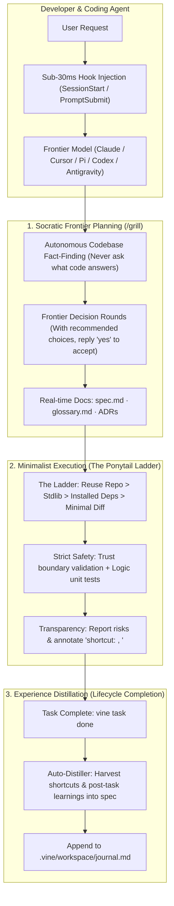

<p align="center">
  <h1 align="center">🌿 Vine</h1>
  <p align="center">
    <strong>The Agile AI Coding Harness</strong><br>
    <em>Freedom to reason. Discipline to ship.</em>
  </p>
  <p align="center">
    <a href="#english">English</a> • <a href="#-中文说明">简体中文</a>
  </p>
</p>

<p align="center">
  
  
  
  
  
  
</p>

---

## English

### What is Vine?

Modern frontier models (Gemini 2.5/3, Claude 3.5/3.7, GPT-4.5/o1/o3) have evolved far beyond early code-generation bots. Yet legacy AI frameworks still treat them like rigid assembly-line workers—imposing artificial gates, forcing one-question-per-turn bureaucracy, requiring multiple fragmented metadata files, and burning thousands of prompt tokens on orchestration overhead.

**Vine** is a lightweight, pragmatic engineering harness that unchains the model's intellect while keeping your repository disciplined, safe, and organized.

It fuses the best of three battle-tested open-source philosophies:
- 🏛️ **Trellis** (`mindfold-ai/Trellis`): Lifecycle task tracking, living specifications, and sub-millisecond automated hook injection—*completely stripped of bureaucratic micro-management*.
- ✂️ **Ponytail** (`DietrichGebert/ponytail`): The lazy senior developer philosophy—*“The best code is the code never written. Solve with the least new code.”*
- 💡 **grill-with-docs** (`mattpocock/skills`): Socratic Frontier brainstorming—*fact-finding autonomy, batch frontier rounds with recommended choices, and real-time living docs crystallization*.

---

### Comparison

| Dimension | Legacy Harnesses (e.g. Trellis) | Minimal Prompts (e.g. Ponytail) | **Vine (This Project)** |
| :--- | :--- | :--- | :--- |
| **Model Philosophy** | Micromanages the agent with multi-phase lockouts | Unconstrained single prompt, no persistent task board | **Guided Autonomy**: Guardrails without handcuffs |
| **Questions & Planning** | Rigid: forced 1 question per turn, PRD/Design splits | None: skips questioning | **Socratic Frontier**: Batched decision rounds with recommendations |
| **Fact Finding** | Often asks user obvious codebase questions | N/A | **Fact Independence**: Search repo first; never ask what code knows |
| **Code Implementation** | Heavy wrappers, forces multi-agent delegation | The Ponytail Ladder: minimum viable code diff | **Ponytail Ladder**: Reuse > Stdlib > Installed > Minimal working code |
| **Living Documentation** | Complex nested manual specs | None | **Real-time Docs**: Inline `glossary.md` updates & ADR generation |
| **Lifecycle & Memory** | Heavy multi-file tracking (`prd`, `design`, `jsonl`) | Diff only | **Unified `spec.md` + Notes**; auto post-task learning distillation |
| **Runtime Footprint** | Multi-language, heavy CLI dependencies | Node scripts | **Zero-dependency Python 3 standard library** + 23 kB npm wrapper |
| **Hook Latency** | 200ms – 1000ms multi-process execution | Fast | **Sub-30ms** instant stream injection |

---

### Architecture



---

### Quick Start

#### 1. Installation

Install via npm (recommended, zero-install via npx available) or pip:

```bash
# Option A: Global via npm
npm install -g vine-harness

# Option B: Run instantly via npx (zero installation)
npx vine-harness init

# Option C: Python package
pip install -e .
```

#### 2. Initialize in Your Repository

Vine supports **on-demand platform initialization** (like Trellis), creating only the adapters you actually use:

```bash
# Initialize only the platforms you need:
vine init --cursor --pi -u alice
vine init --claude --codex -u bob

# Or initialize all platforms:
vine init --all

# Or default auto-detection:
vine init
```

Supported platform flags:
- `--cursor`: Generates `.cursor/rules/vine.mdc`
- `--pi`: Generates `.pi/extensions/vine.js`
- `--claude`: Generates `.claude/settings.json` (SessionStart & UserPromptSubmit hooks)
- `--codex`: Generates `.codex/hooks.json`
- `--opencode`: Generates `.opencode/hooks.json`
- `--gemini`: Generates `AGENTS.md`

Add more platforms to an existing project at any time:
```bash
vine add codex
vine add pi
```

---

### Workflow & Commands

#### Task Lifecycle (`vine task`)
```bash
# Create task and enter planning mode (auto-activates context injection)
vine task new "Implement Token Bucket Rate Limiter" --desc "In-memory token bucket for API gateway"

# Check active task status & spec summary
vine task status

# List all tasks
vine task list

# Switch active task
vine task start 2026-10-13-token-bucket

# Complete task & automatically distill learnings into .vine/spec/conventions.md
vine task done

# Archive completed task
vine task archive 2026-10-13-token-bucket
```

#### Living Specs & Domain Knowledge (`vine spec`)
```bash
# View living specifications
vine spec show [all | conventions | architecture | glossary]

# Clarify domain terms inline during brainstorming
vine spec term "TokenBucket" "Algorithm accumulating tokens at fixed rate" --context "API Gateway"

# Record high-impact Architectural Decision Records (ADRs)
vine spec adr "Use Python Stdlib Dict over Redis" \
  --context "Single node deployment, low latency requirement" \
  --decision "Use threading.Lock and native dict" \
  --consequences "Zero external dependency, must refactor if clustering"
```

#### Senior Dev Review Checklist (`vine review`)
```bash
vine review
```
Displays the Ponytail senior dev inspection checklist: outside-the-diff impact, unrequested abstractions, security boundaries, and untested logic branches.

---

### Pi Coding Agent (`pi`) Integration

Vine provides first-class native extension support for **Pi Agent** (`@mariozechner/pi-coding-agent`):

```bash
# Install directly in Pi
pi install npm:vine-harness
```
Inside the Pi terminal UI, you get:
- Automatic `systemPrompt` context injection via `before_agent_start`.
- Slash commands:
  - `/vine [status | new | done | list | review]`
  - `/grill`: Enter Socratic Frontier brainstorming.
  - `/vine-review`: Senior dev code inspection.

---

<br>

## 🌿 中文说明

### 什么是 Vine？

随着前沿大语言模型（如 Gemini 2.5/3、Claude 3.5/3.7、GPT-4.5/o1/o3）代码理解与工程推理能力的跨越式提升，传统的 AI Agent 框架往往用沉重的“流水线规约”把高智商模型当流水线工人对待——强制单步问答、强制拆分多层琐碎文件、强制多阶段子代理分发，带来了严重的 Token 浪费与交互迟滞。

**Vine**（藤蔓）是一个专为现代高智商 Coding Agent 设计的轻量级敏捷工程底座。

它融合了三大开源项目的精髓：
- 🏛️ **Trellis**：任务生命周期管理、活文档 Spec 沉淀、毫秒级原生 Hook 上下文注入；**彻底剥离了繁文缛节与流程死锁**。
- ✂️ **Ponytail**：极简高级工程师直觉——*“写最少的代码解决全部问题”*；解题极简阶梯（复用 > 标准库 > 依赖 > 最小改动）；严防安全边界与核心逻辑测试；标记故意技术债 `shortcut:`。
- 💡 **grill-with-docs**：苏格拉底式启发提问——*自主探查代码库事实（不问已知代码）；决策树前沿（Frontier）成组提问并附带推荐选项（支持单字 `yes` 批量确认）；实时沉淀词汇表与 ADR 决策记录*。

---

### 核心特性

1. **零外部依赖内核**：100% Python 3 标准库构建，跨 Windows/macOS/Linux 即插即用；提供仅 23 kB 的轻量 npm/npx 启动层。
2. **按需平台初始化**：类似 Trellis，支持一键针对特定平台生成适配文件（`--cursor`, `--pi`, `--claude`, `--codex`, `--opencode`, `--gemini`, `--all`），随时支持 `vine add <platform>` 追加。
3. **极速无感 Hook**：`.vine/hooks/session_start.py`（<30ms 读取活跃任务与规约），`prompt_submit.py`（输出单行紧凑状态锚点），始终锚定目标，绝不卡死流程。
4. **活文档自愈与经验萃取**：任务完成执行 `vine task done` 时，自动提取代码与笔记中的 `shortcut:` 标注和复盘认知，沉淀入 `.vine/spec/conventions.md`。

---

### 快速上手

```bash
# 1. 安装（npm 全局或免安装 npx）
npm install -g vine-harness
# 或直接通过 npx 即开即用
npx vine-harness init

# 2. 按需初始化你的 IDE / Agent 适配
vine init --cursor --pi -u your-name
# 或初始化全部平台
vine init --all -u your-name

# 3. 创建任务并启动规划
vine task new "实现速率限制器" --desc "基于令牌桶算法的高吞吐 API 速率控制"

# 4. 在 AI 会话中直接提问或开发，Hook 会自动注入上下文！
```

---

### 常用命令速查

| 指令 | 说明 |
| :--- | :--- |
| `vine init [--cursor\|--pi\|--claude\|--all]` | 按需初始化工程底座与平台适配文件 |
| `vine add <platform>` | 为已有项目追加平台集成（如 `vine add codex`） |
| `vine task new "<title>" [--desc "<desc>"]` | 创建新任务并自动切换为当前活跃状态（激活 Hook） |
| `vine task status` | 查看当前激活任务的详细信息与 Spec 摘要 |
| `vine task list [-a]` | 列出所有任务（状态看板） |
| `vine task start <id>` | 切换当前激活的任务 |
| `vine task done` | 标记任务完成，自动提炼经验与技术债到 `conventions.md` |
| `vine task archive <id>` | 归档已完成任务至 `archive/` 目录 |
| `vine spec show [category]` | 查看当前项目沉淀的规范、架构或词汇表 |
| `vine spec term "<word>" "<def>"` | 在讨论中澄清核心概念，实时写入领域词汇表 |
| `vine spec adr "<title>" --context ...` | 记录高影响度的架构决策记录（ADR） |
| `vine review` | 输出 Ponytail Senior Dev 极简自检清单 |

---

## License

[MIT](LICENSE). The shortest license that works.
